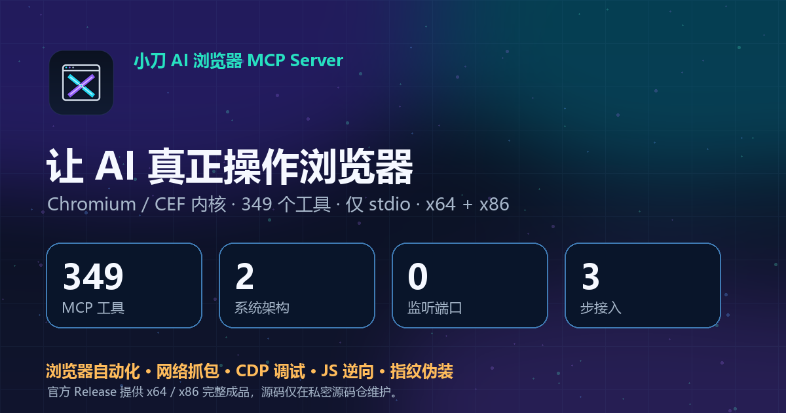
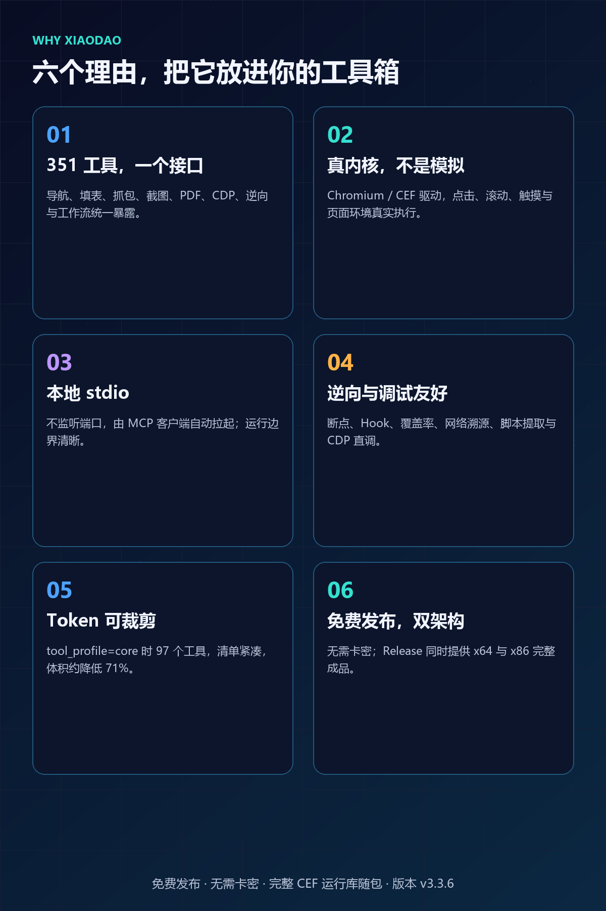
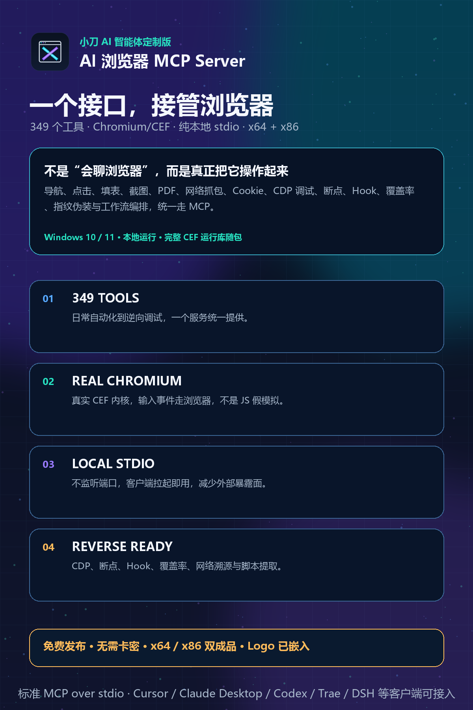
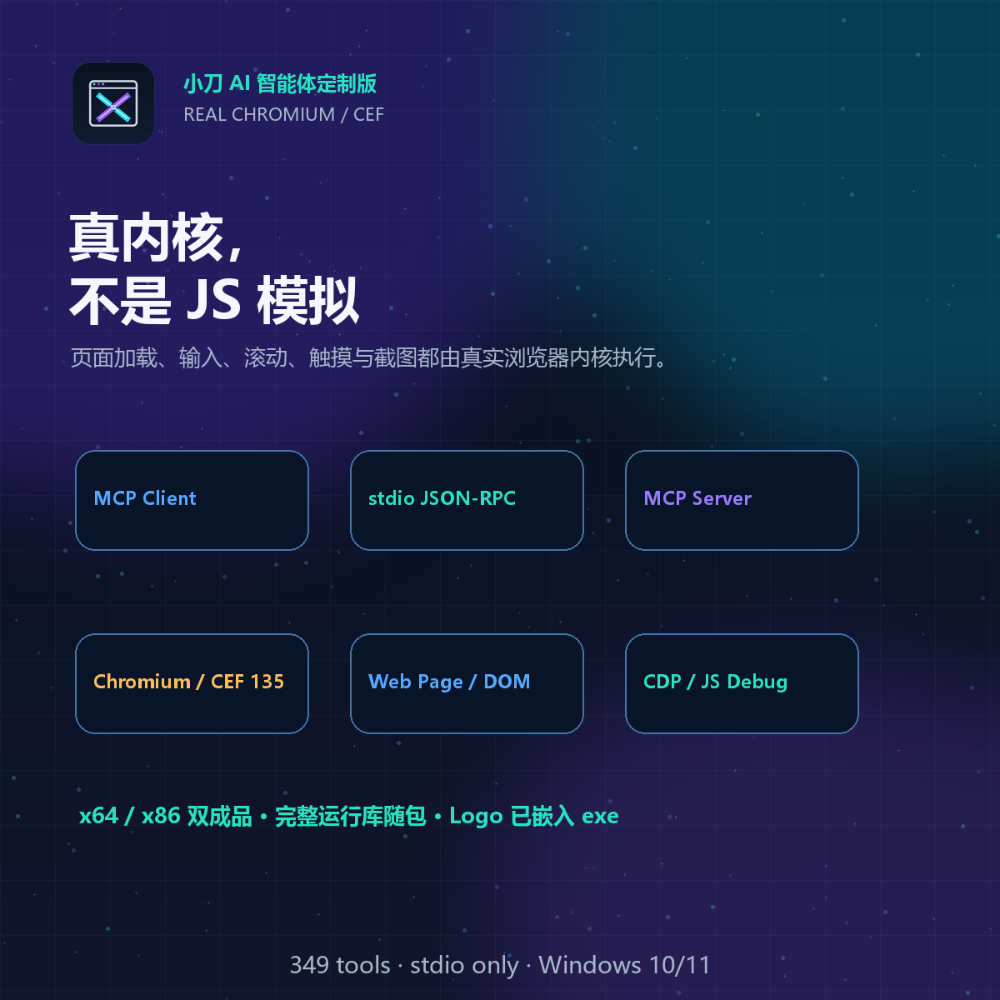
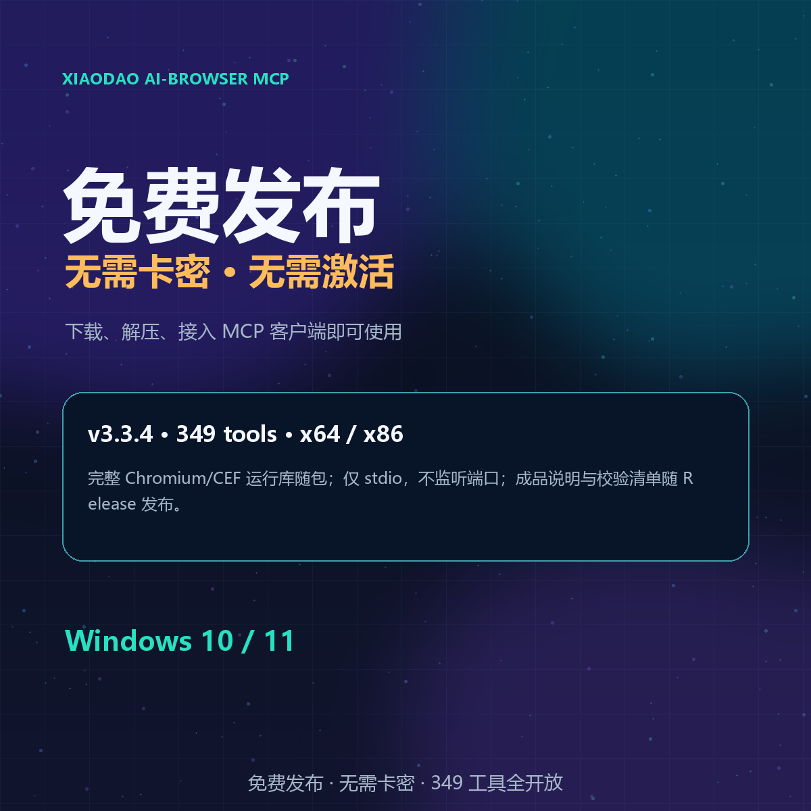

<p align="center"></p>
<p align="center"></p>

**Xiaodao AI-Browser MCP Server（小刀 AI 浏览器 MCP 服务端）** is a local **browser automation MCP server for Windows** built on the **Chromium / CEF** kernel. It speaks **MCP over stdio** (no ports, no daemon) and exposes **349 tools** covering navigation, extraction, form filling, screenshots/PDF, **network capture & HAR export**, **Chrome DevTools Protocol (CDP)** control, **JavaScript debugging & reverse engineering** (function hooks, hot patching, precise coverage, obfuscation detection), **anti-detect fingerprinting**, and **kernel-level CEF events**.
关键词 / Keywords: MCP server, browser automation, Chromium, CEF, CDP, Chrome DevTools Protocol, web scraping, HAR, Playwright alternative, Puppeteer alternative, reverse engineering, JS debugging, anti-detect, fingerprint, headless-less local browser, Windows, Claude Desktop, Cursor, Trae, DeepSeek Harness, 浏览器自动化, 逆向, 指纹, 反检测.

## 宣传图 / Promo
| | |
|---|---|
|  |  |
|  |  |
   

**支持/Support:** [SUPPORT.md](SUPPORT.md) · **安全/Security:** [SECURITY.md](SECURITY.md) · **许可/License:** [LICENSE](LICENSE) · **兼容性:** [docs/COMPATIBILITY.md](docs/COMPATIBILITY.md) · **部署:** [docs/DEPLOYMENT.md](docs/DEPLOYMENT.md) · **架构:** [docs/ARCHITECTURE.md](docs/ARCHITECTURE.md) · **SBOM:** [docs/SBOM.md](docs/SBOM.md) · **路线图:** [docs/ROADMAP.md](docs/ROADMAP.md) · **签名:** [docs/CODE-SIGNING.md](docs/CODE-SIGNING.md)

# Xiaodao AI-Browser MCP Server · 小刀 AI 浏览器 MCP Server

Windows 本地浏览器自动化 MCP 服务端 —— **Google Chromium / CEF** 内核、仅 stdio 通道（`--mcp-stdio`）、**349** 个工具。
A local browser-automation MCP server for Windows (Chromium/CEF, stdio-only, 349 tools).

**最新版本 / Latest: `v3.3.4`** → 见 [Releases](../../releases)；源码在私密仓 `AI-XiaoDao/xiaodao-ai-browser-mcp-src`。

## 安装（三步） / Install (3 steps)
1. 下载并解压 `xiaodao-ai-browser-mcp-v3.3.4-x64.zip` → Download & unzip the x64 package
2. 以 `AI-Fbowser-Mcp.exe` 所在目录为运行目录 → Use the folder containing `AI-Fbowser-Mcp.exe` as the working directory
3. `AI-Fbowser-Mcp.exe --print-config` 输出可直接粘贴进 MCP 客户端配置的 JSON（自动带本机真实路径）
   → `--print-config` prints a ready-to-paste `mcpServers` JSON block with the real local path.
   需要离线运行时请直接使用 zip 内的完整 CEF 运行库；本版未单独发布 DSH 安装器。

## 环境变量 / Environment
| 变量 | 作用 |
|---|---|
| `AI_BROWSER_MCP_STDERR_UTF8=1` | 把日志(stderr)编码从默认 **936/GBK** 切到 **UTF-8**（`true/yes/on` 亦可）。默认 GBK 与中文 Windows 控制台一致，**完全向后兼容**；非中文 Windows 或期望 UTF-8 日志时置此变量。 |
| `AI_BROWSER_MCP_TOOLS_DIR` | 工具目录（一般无需手工设置，安装器会写） |

> 实测：同一构建，UTF-8 模式下按 UTF-8 解码替换符 **0** 个；不置变量时按 GBK 解码替换符 **6** 个。
> 另查实：默认模式 stderr 为**混合编码**（项目日志 GBK + CEF 子进程 UTF-8）⇒ 置变量后整条流统一 UTF-8。

## 资产 / Release assets
| 文件 | 说明 |
|---|---|
| `xiaodao-ai-browser-mcp-v3.3.4-x64.zip` | 成品 x64（349 工具，含完整 CEF 运行库与 Logo 资源；内层 exe MD5 `245F19E1CBEF1B7C02CBC6003E66A4F7`，9,282,048 B） |
| `00-checksums-sha256-md5.csv` | 资产 MD5 + SHA256 |

## 验收（机对机） / Verification
编译 `0 错误 0 警告`（x64）；349 工具全量扫描发现 2 个“暂停态无回包”，已修复并完成专项回归
（paused guard / cancel / touch / batch / retry），另有帧族 P1–P8、CL 失配两向、工作池饱和读线程快答
（`tools/list` 94ms，修前 11267ms）、CDP 层诚实性、客户端矩阵 7/7 等历史回归证据。

## 已知边界 / Known limits

完整审计报告与证据：**[docs/AUDIT-3.3.4.md](docs/AUDIT-3.3.4.md)**

- exe **未做代码签名**（SmartScreen 会提示）· no code signing yet
- 缓存库"内容型"毒化触发条件不可构造，仅有启发式安全网 · cache-DB content-poisoning has no reproducible trigger (heuristic net only)
- 非 `tools/call` 的 `initialize`/`workflow_stop` 在全忙期仍入队（有界延迟，不丢请求）· those still queue while the worker pool is saturated (bounded, never dropped)

## 仓库结构 / Repository layout

```nREADME.md                  本文件（中英双语）
docs/QUICKSTART_ZH.md     快速上手（中文）
docs/QUICKSTART_EN.md     Quick Start (English)
docs/CHANGELOG.md         更新日志
docs/VERIFICATION.md      验收事实（机对机证据）
docs/KNOWN-LIMITS.md      已知边界
examples/mcp_config.example.json  客户端配置示例（含 UTF-8 开关）
assets/                    图标与预览图
```n
> 二进制成品不进入 Git 历史，全部随 [Releases](../../releases) 分发。

## 能力与优势 / Capabilities & Advantages

- **能力清单（按域归类，349 工具）**：[docs/CAPABILITIES.md](docs/CAPABILITIES.md)
- **优势与差异化（每条均可核验）**：[docs/ADVANTAGES.md](docs/ADVANTAGES.md)

