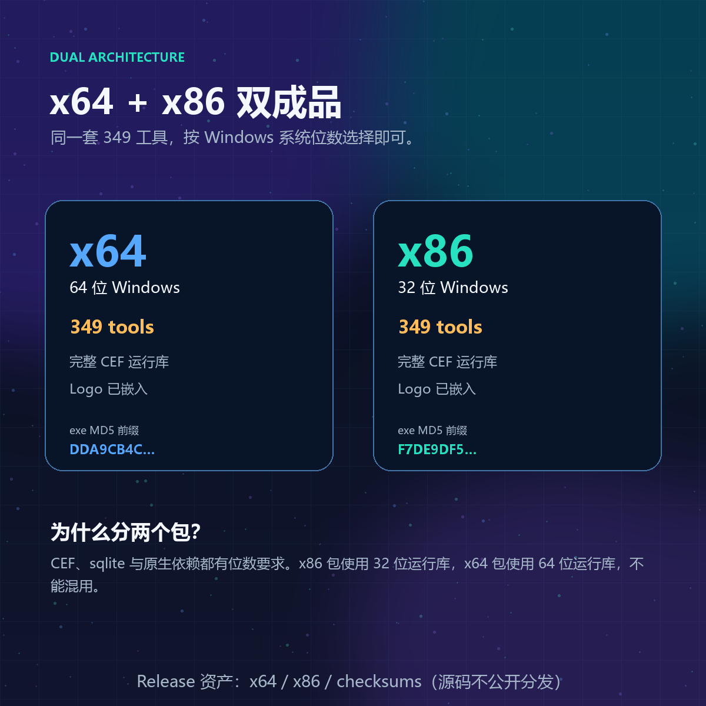
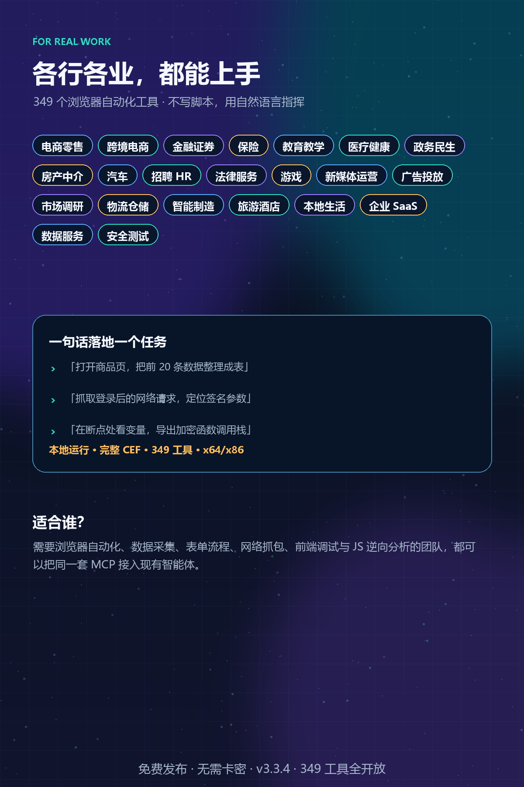

<p align="center"></p>
<p align="center"></p>

**Xiaodao AI-Browser MCP Server（小刀 AI 浏览器 MCP 服务端）** is a local **browser automation MCP server for Windows** built on the **Chromium / CEF** kernel. It speaks **MCP over stdio** (no ports, no daemon) and exposes **349 tools** covering navigation, extraction, form filling, screenshots/PDF, **network capture & HAR export**, **Chrome DevTools Protocol (CDP)** control, **JavaScript debugging & reverse engineering** (function hooks, hot patching, precise coverage, obfuscation detection), **anti-detect fingerprinting**, and **kernel-level CEF events**.
关键词 / Keywords: MCP server, browser automation, Chromium, CEF, CDP, Chrome DevTools Protocol, web scraping, HAR, Playwright alternative, Puppeteer alternative, reverse engineering, JS debugging, anti-detect, fingerprint, headless-less local browser, Windows, Claude Desktop, Cursor, Trae, DeepSeek Harness, 浏览器自动化, 逆向, 指纹, 反检测.

   

## 宣传图 / Promo
| 产品全貌 | 六卖点 |
|---|---|
|  |  |

| x64 + x86 双架构 | 行业场景 |
|---|---|
|  |  |

另有 [真 Chromium 内核](assets/promo/xiaodao-mcp-real-chromium-kernel.png) 与 [免费发布](assets/promo/xiaodao-mcp-free-no-license-key.png) 卡片。素材规格见 [assets/promo/README.md](assets/promo/README.md)。
**支持/Support:** [SUPPORT.md](SUPPORT.md) · **安全/Security:** [SECURITY.md](SECURITY.md) · **许可/License:** [LICENSE](LICENSE) · **兼容性:** [docs/COMPATIBILITY.md](docs/COMPATIBILITY.md) · **部署:** [docs/DEPLOYMENT.md](docs/DEPLOYMENT.md) · **架构:** [docs/ARCHITECTURE.md](docs/ARCHITECTURE.md) · **SBOM:** [docs/SBOM.md](docs/SBOM.md) · **路线图:** [docs/ROADMAP.md](docs/ROADMAP.md) · **签名:** [docs/CODE-SIGNING.md](docs/CODE-SIGNING.md)

# Xiaodao AI-Browser MCP Server · 小刀 AI 浏览器 MCP Server

Windows 本地浏览器自动化 MCP 服务端 —— **Google Chromium / CEF** 内核、仅 stdio 通道（`--mcp-stdio`）、**349** 个工具。
A local browser-automation MCP server for Windows (Chromium/CEF, stdio-only, 349 tools).

**最新版本 / Latest: `v3.3.4`** → 见 [Releases](../../releases)。本仓只发布成品；源码维护在私密仓 `AI-XiaoDao/xiaodao-ai-browser-mcp-src`，不在 Release 或本仓公开。

## 快速下载 / Quick download
| 系统 | 选择 | 包内内容 |
|---|---|---|
| 64 位 Windows 10/11 | `xiaodao-ai-browser-mcp-v3.3.4-x64.zip` | 349 工具 + 完整 64 位 CEF 运行库 + Logo |
| 32 位 Windows 10/11 | `xiaodao-ai-browser-mcp-v3.3.4-x86.zip` | 349 工具 + 完整 32 位 CEF 运行库 + Logo |

不要混用两个包：CEF、sqlite 与原生 DLL 都有位数要求。

## 安装（三步） / Install (3 steps)

1. 按系统位数下载并解压对应 zip → Download & unzip the package for your Windows architecture
2. 以 `AI-Fbowser-Mcp.exe` 所在目录为运行目录 → Use the folder containing `AI-Fbowser-Mcp.exe` as the working directory
3. `AI-Fbowser-Mcp.exe --print-config` 输出可直接粘贴进 MCP 客户端配置的 JSON（自动带本机真实路径）
   → `--print-config` prints a ready-to-paste `mcpServers` JSON block with the real local path.

下载行为：默认 `auto_download_save=true`，浏览器内点击下载会**静默保存**到运行目录的 `Downloads`，不会弹“另存为”。页面下载完成时，`browser_event` 可查 `download_start / download_progress / download_complete`。

## 环境变量 / Environment
| 变量 | 作用 |
|---|---|
| `AI_BROWSER_MCP_STDERR_UTF8=1` | 把日志(stderr)编码从默认 **936/GBK** 切到 **UTF-8**（`true/yes/on` 亦可）。默认 GBK 与中文 Windows 控制台一致，**完全向后兼容**；非中文 Windows 或期望 UTF-8 日志时置此变量。 |
| `AI_BROWSER_MCP_TOOLS_DIR` | 工具目录（一般无需手工设置，安装器会写） |

> 实测：同一构建，UTF-8 模式下按 UTF-8 解码替换符 **0** 个；不置变量时按 GBK 解码替换符 **6** 个。
> 另查实：默认模式 stderr 为**混合编码**（项目日志 GBK + CEF 子进程 UTF-8）⇒ 置变量后整条流统一 UTF-8。

## 资产 / Release assets
| 文件 | 说明 |
|---|---|
| `xiaodao-ai-browser-mcp-v3.3.4-x64.zip` | 64 位成品（349 工具，完整 CEF 运行库与 Logo；165,655,537 B；内层 exe MD5 `8FFFCF297EEB2B0FB83A5B93AAA3AA21`，9,285,120 B） |
| `xiaodao-ai-browser-mcp-v3.3.4-x86.zip` | 32 位成品（349 工具，完整 32 位 CEF 运行库与 Logo；144,073,249 B；内层 exe MD5 `7F5B5BE9950B6B28400B9C4A08A76C6E`，7,684,608 B） |
| `00-checksums-sha256-md5.csv` | 全部发布资产的 MD5 + SHA256 |

## 验收（机对机） / Verification
`v3.3.4` 最终构建：x64 / x86 均为 **0 错误、0 警告**。

- **x64 最终全量扫描：335 成功、14 个明确失败、0 无回包、0 进程退出**。14 个失败均属于安全确认、缺失外部插件、内核明确不支持或需要特定暂停现场的负向用例，不是协议挂起。
- **x86 最终全量扫描：334 成功、15 个明确失败、0 无回包、0 进程退出**（包含被移除的测试夹具项；其余失败性质同上）。
- `browser_resources` 的 x86 回调 ABI 问题已修复：x86 返回 `metrics_available:false`，不再把未知统计伪装成可用；x64 继续返回完整指标。
- 截图、PDF 的 `save_to/path` 现在自动创建父目录；`browser_reverse_heap` 的 snapshot 改为异步提交，单次约 30–95ms 返回，不再占死工作池。
- 下载路径已消除运行目录尾斜杠造成的双反斜杠；x64/x86 均实测 `Downloads\audit.txt` 落盘成功。
- `browser_fingerprint_ua` 默认安全拒绝并在约 1 秒内返回原因；只有显式 `confirm:true` 才进入高风险渲染器切换路径。
- `tools/list` 读线程快答、CDP 诚实性、客户端矩阵 7/7、取消通知、帧族与工作池回归证据保留在 [docs/AUDIT-3.3.4.md](docs/AUDIT-3.3.4.md)。

## 已知边界 / Known limits

完整审计报告与证据：**[docs/AUDIT-3.3.4.md](docs/AUDIT-3.3.4.md)**

- exe **未做代码签名**（SmartScreen 会提示）· no code signing yet
- 缓存库"内容型"毒化触发条件不可构造，仅有启发式安全网 · cache-DB content-poisoning has no reproducible trigger (heuristic net only)
- 非 `tools/call` 的 `initialize`/`workflow_stop` 在全忙期仍入队（有界延迟，不丢请求）· those still queue while the worker pool is saturated (bounded, never dropped)
- x86 构建暂不启用进程/CacheData 内联统计（会破坏回调 ABI），`browser_resources` 明确返回 `metrics_available:false`。
- 虚拟 UA、预注入插装等会重启渲染器或阻塞调试通道的操作默认需要显式确认；这是内核能力边界，不是静默成功。

## 仓库结构 / Repository layout

```
README.md                  本文件（中英双语）
docs/QUICKSTART_ZH.md     快速上手（中文）
docs/QUICKSTART_EN.md     Quick Start (English)
docs/CHANGELOG.md         更新日志
docs/VERIFICATION.md      验收事实（机对机证据）
docs/KNOWN-LIMITS.md      已知边界
examples/mcp_config.example.json  客户端配置示例（含 UTF-8 开关）
assets/                    图标与宣传图（assets/promo）
```
> 二进制成品不进入 Git 历史，全部随 [Releases](../../releases) 分发。
> 发布仓只包含成品、文档、测试与宣传资源；源码不会进入发布仓。

## 能力与优势 / Capabilities & Advantages

- **能力清单（按域归类，349 工具）**：[docs/CAPABILITIES.md](docs/CAPABILITIES.md)
- **优势与差异化（每条均可核验）**：[docs/ADVANTAGES.md](docs/ADVANTAGES.md)

